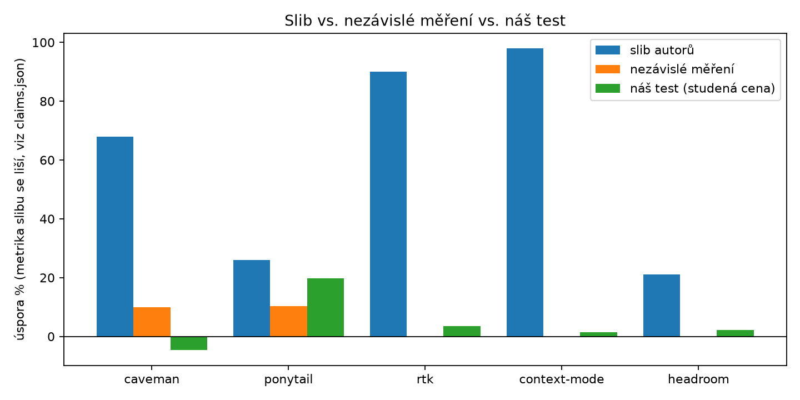
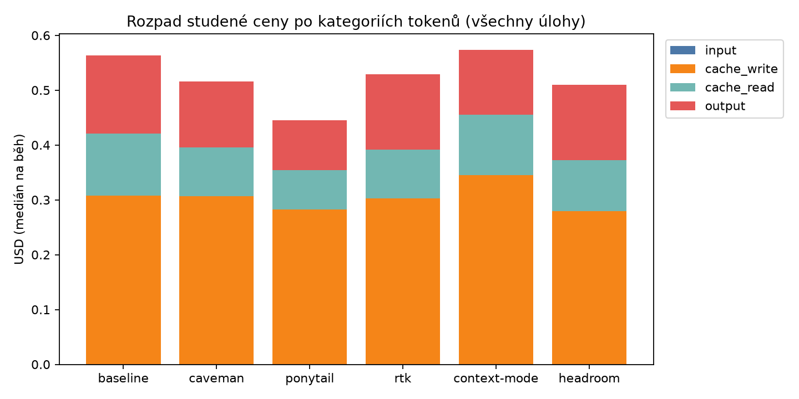
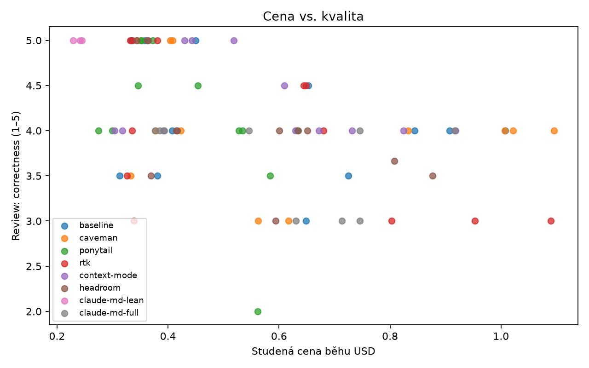
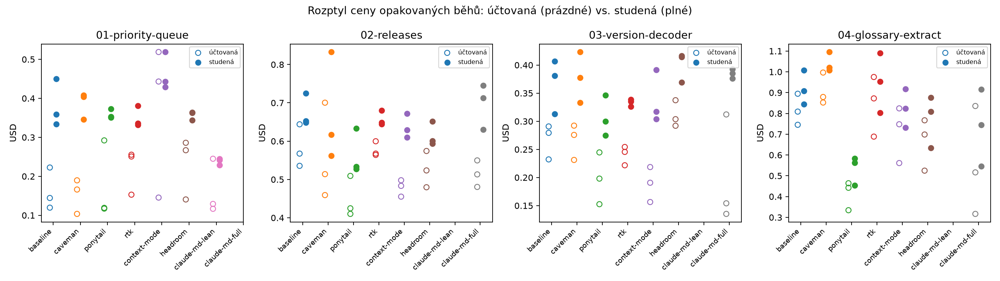

# Šetří doplňky Claude Code tokeny? Výsledky cc-token-bench

Datum měření: 19.–20. 10. 2026 · Claude Code 2.1.303 · model `claude-sonnet-5-5`, effort `medium`
· 72 běhů (4 úlohy × 6 konfigurací × 3 opakování) + 12 běhů pokusu s CLAUDE.md · zadání: [docs/cc-token-bench-zadani.md](docs/cc-token-bench-zadani.md)

## Shrnutí

- **Jen Ponytail ušetřil čitelně a konzistentně**, a to na úlohách, kde agent píše hodně kódu:
  −18 % (úloha 02), −21 % (úloha 03) a −38 % (úloha 04 s objemnými daty). U malé opravy chyby
  (úloha 01) vyšel prakticky nulově (−2 %). V průměru přes čtyři úlohy −20 %. Mechanismus je
  v datech vidět: menší diffy (na úloze 04 75–95 řádků proti 163–218), méně tahů, méně čtení.
  Skryté testy prošly ve všech bězích. Na úloze 04 ale review hodnotilo správnost Ponytailu hůř
  než baseline (medián 3,5 proti 4) a v jednom běhu našlo skutečnou chybu, kterou skryté testy
  nepokrývají (viz [Kvalita](#kvalita)).
- **Úloha s objemnými daty (04) nástrojům na kontext nepomohla.** Agent měl k dispozici 38 MB HTML
  specifikací, 1,5MB JSON a log, ale četl je cíleně přes `grep` a výřezy: do kontextu se z nich
  dostalo 15–60 tisíc znaků na běh. Největší jednotlivý výstup nástroje měl 45 tisíc znaků a byl to
  zdrojový soubor, ne data. Žádný běh nenarazil na kompakci ani limit kontextu. Context Mode
  ani tady nedostal jediné volání svých MCP nástrojů. **RTK vyšel na úloze 04 o 5 % dráž**,
  přestože sám hlásí úsporu 5,6–11 tisíc tokenů na běh. Objem výsledků nástrojů v kontextu
  se u RTK nezmenšil (115 tisíc znaků proti 107 tisícům u baseline).
- **Caveman, RTK, Context Mode a Headroom cenu v průměru přes čtyři úlohy nezměnily**
  (+5 %, −4 %, −1 %, −2 %). Jednotlivé úlohy se rozcházejí oběma směry v rozsahu, který při třech
  bězích nelze odlišit od šumu. Caveman byl na úloze 04 o 13 % dražší.
- **Vlastní CLAUDE.md rozhodl víc než většina doplňků.** Zkrácení CLAUDE.md z 67 na 7 KB
  zlevnilo krátkou opravu chyby (úloha 01) o 33 %, s těsným rozptylem. U delších úloh 02 a 03
  naopak 67KB verze přidala jen +9 % a +1 %: velký CLAUDE.md se zapíše do cache jednou a dál se
  čte levně, takže nejvíc prodražuje krátké relace. Obě verze se ale liší i obsahem, ne jen
  velikostí (viz [Pokus](#pokus-velikost-claudemd)).
- **Sliby autorů (21–98 %) se týkají jiných veličin než účtu.** Výstup bashe, objem výstupu
  nástroje nebo slova odpovědi tvoří v agentní práci malou část ceny. Účet je ovládán zápisem
  a čtením cache promptů, tedy kontextem, který agent nese z tahu do tahu.
- **Skryté testy prošly v 71 ze 72 hlavních běhů.** Úlohy 01–03 byly pro model snadné (54/54),
  teprve úloha 04 kvalitu rozlišila: jeden běh s Headroomem neprošel (31 šumových „definic“
  ve výstupu), stejně jako 2 ze 3 běhů pokusu s 67KB CLAUDE.md (ztracené zkratky).
- **Důležitá metodická poznámka:** skutečně účtovaná cena jednotlivých běhů je silně ovlivněna
  tím, zda krátce předtím běžel jiný běh se stejným začátkem promptu (sdílená cache promptů).
  Bez očištění by z dat vyšlo, že Context Mode prodražuje úlohu 01 o 207 % a Ponytail šetří 29 %.
  Obojí je z velké části artefakt pořadí běhů. Hlavní srovnání proto děláme na „studené ceně“
  (viz [Metodika](#cena-a-sdílená-cache)).

## Výsledky

### Souhrn přes úlohy

Změna = průměr relativních změn mediánu proti baseline téže úlohy přes čtyři úlohy (záporné = úspora).
Neúspěšné běhy jsou v mediánech započítané se svou cenou.

| Konfigurace | Změna studené ceny | Změna účtované ceny | Změna času | Skryté testy | Review správnost | Review rozsah |
|---|---|---|---|---|---|---|
| baseline | 0 % | 0 % | 0 % | 12/12 | 4,08 | 4,45 |
| caveman | +4,7 % | +3,2 % | +7,7 % | 12/12 | 4,04 | 4,41 |
| **ponytail** | **−19,9 %** | −29,3 % | −32,6 % | 12/12 | 4,12 | 4,83 |
| rtk | −3,5 % | +17,3 % | −1,5 % | 12/12 | 3,95 | 4,41 |
| context-mode | −1,5 % | +38,2 % | −20,4 % | 12/12 | 4,29 | 4,75 |
| headroom | −2,3 % | +18,0 % | +1,6 % | 11/12 | 4,05 | 4,54 |

Jen přes úlohy 01–03 (bez objemných dat) vychází: caveman +2,0 %, ponytail −13,8 %, rtk −6,4 %,
context-mode +1,1 %, headroom +0,6 %. Úloha 04 tedy obraz nezměnila, jen zesílila Ponytail
a oslabila RTK.

### Úloha × konfigurace (studená cena)

Medián tří běhů, v závorce min–max. Δ = změna mediánu proti baseline téže úlohy.
„Výchozí prompt“ = tokeny prvního volání API (systémový prompt, definice nástrojů, CLAUDE.md, zadání).

| Úloha | Konfigurace | USD (min–max) | Δ cena | Výchozí prompt (Δ) | Řádky kódu v diffu | Tahy | Čas s |
|---|---|---|---|---|---|---|---|
| 01 oprava chyby | baseline | 0,36 (0,33–0,45) | – | 58 264 | 77 | 5 | 55 |
| | caveman | 0,40 (0,35–0,41) | +12,6 % | +3 765 | 77 | 7 | 99 |
| | ponytail | 0,35 (0,35–0,37) | −1,7 % | +1 583 | 56 | 5 | 48 |
| | rtk | 0,34 (0,33–0,38) | −6,3 % | +218 | 65 | 4 | 54 |
| | context-mode | 0,44 (0,43–0,52) | +23,6 % | +14 540 | 84 | 8 | 48 |
| | headroom | 0,36 (0,34–0,36) | +1,2 % | −959 | 76 | 6 | 69 |
| 02 refaktoring | baseline | 0,65 (0,65–0,72) | – | 30 153 | 317 | 28 | 372 |
| | caveman | 0,62 (0,56–0,83) | −5,6 % | +3 765 | 275 | 24 | 272 |
| | ponytail | 0,53 (0,53–0,63) | −18,3 % | +1 583 | 242 | 21 | 235 |
| | rtk | 0,65 (0,64–0,68) | −0,7 % | +218 | 307 | 26 | 293 |
| | context-mode | 0,63 (0,61–0,67) | −3,6 % | +14 540 | 289 | 24 | 244 |
| | headroom | 0,60 (0,59–0,65) | −8,0 % | −959 | 286 | 29 | 347 |
| 03 nová funkce | baseline | 0,38 (0,31–0,41) | – | 29 808 | 267 | 8 | 118 |
| | caveman | 0,38 (0,33–0,42) | −1,0 % | +3 765 | 294 | 10 | 120 |
| | ponytail | 0,30 (0,27–0,35) | −21,4 % | +1 583 | 211 | 7 | 82 |
| | rtk | 0,34 (0,33–0,34) | −12,1 % | +218 | 280 | 9 | 130 |
| | context-mode | 0,32 (0,30–0,39) | −16,7 % | +14 540 | 222 | 6 | 93 |
| | headroom | 0,41 (0,37–0,42) | +8,8 % | −959 | 275 | 14 | 133 |
| 04 objemná data | baseline | 0,91 (0,84–1,01) | – | 29 069 | 211 | 40 | 536 |
| | caveman | 1,02 (1,01–1,10) | +12,6 % | +3 765 | 258 | 40 | 407 |
| | ponytail | 0,56 (0,45–0,58) | **−38,1 %** | +1 583 | 80 | 25 | 261 |
| | rtk | 0,95 (0,80–1,09) | +5,0 % | +218 | 308 | 33 | 570 |
| | context-mode | 0,82 (0,73–0,92) | −9,2 % | +14 540 | 219 | 31 | 463 |
| | headroom | 0,81 (0,63–0,88) | −10,9 % | −959 | 160 | 30 | 397 |

Úplné tabulky včetně účtované ceny a rozpadu po kategoriích tokenů:
[analysis/out/summary.md](analysis/out/summary.md), data v [analysis/out/](analysis/out/).

### Kde se platí

Podíl kategorií na studené ceně baseline:

| Úloha | Zápis do cache | Čtení z cache | Výstup | Nové vstupy |
|---|---|---|---|---|
| 01 | 76 % | 11 % | 13 % | 0 % |
| 02 | 48 % | 24 % | 28 % | 0 % |
| 03 | 65 % | 10 % | 25 % | 0 % |
| 04 | 45 % | 29 % | 26 % | 0 % |

Výstupní tokeny, na které míří Caveman, tvoří 13–28 % ceny, a próza odpovědí z nich jen asi 6 %
(zbytek je kód zapisovaný přes nástroje a přemýšlení modelu, cca 19 %). Úloha 01 začíná se 58 tisíci
tokeny kontextu, protože snapshot projektu obsahuje 67 KB CLAUDE.md. Tři čtvrtiny její ceny je
jednorázový zápis tohoto kontextu do cache. Doplněk, který kontext zvětší, ji tím prodraží, a žádný
doplněk ho nezmenší.

### Úloha 04: objemná data

Úloha 04 vznikla dodatečně, aby měly RTK, Context Mode a Headroom příležitost, pro kterou jsou
stavěné. Agent opravuje extrakci glosáře, která ztrácí definice. K dispozici má korpus 303 HTML
specifikací (38 MB) a výstup chybného běhu: 1,5MB `extracted-glossary.json`, rozdílový JSON, seznam
zkratek a log. Zadání jmenuje dva konkrétní dokumenty s chybějícími definicemi a říká, že problém
se týká i dalších. Bez práce s daty se příčina najít nedá.

Co agent z velkých dat skutečně četl (výsledky volání nástrojů, jejichž vstup se týkal korpusu,
JSON nebo logu; medián tří běhů, v závorce rozsah):

| Konfigurace | Z velkých dat do kontextu (znaků) | Všechny výsledky nástrojů (znaků) | Největší jeden výsledek | Volání MCP | Kompakce |
|---|---|---|---|---|---|
| baseline | 38 tis. (33–39) | 107 tis. | 25 tis. | – | 0 |
| caveman | 45 tis. (39–59) | 107 tis. | 26 tis. | – | 0 |
| ponytail | 21 tis. (19–48) | 54 tis. | 28 tis. | – | 0 |
| rtk | 44 tis. (32–46) | 115 tis. | 45 tis. | – | 0 |
| context-mode | 33 tis. (20–39) | 69 tis. | 29 tis. | 0 | 0 |
| headroom | 26 tis. (22–33) | 99 tis. | 45 tis. | – | 0 |

Ze 40 MB dat se do kontextu dostalo nejvýš 60 tisíc znaků. Agent ve všech konfiguracích používal
`grep`, `head`, výřezy podle řádků a krátké skripty v Pythonu a Node, které vypisují počty nebo
vybrané záznamy. Celý JSON ani celou specifikaci nenačetl nikdo. Největší jednotlivý výstup (45 tisíc
znaků) bylo přečtení samotného souboru `extract-glossary.ts`. Nástroje na zkracování výstupů
tak neměly co zkracovat: agent si objemná data filtruje sám dřív, než by se k nim dostaly.

Zbývá situace, kterou tento test nepokrývá: výstup, který agent filtrovat nemůže nebo neumí
(snímek prohlížeče, výpis pádu, dlouhý výstup testu, který potřebuje celý). Pro velké soubory
na disku platí, že je agent sám nečte celé.

Agenti v korpusu našli i třetí skutečnou příčinu, kterou referenční oprava z historie projektu
neřeší: nadpis „Definitions and abbreviations“, kvůli kterému extrakce přeskakuje celé kapitoly.
Skrytý test jsme kvůli tomu museli upravit (viz [Metodika](#úlohy)).

### Co dělaly jednotlivé nástroje

**Ponytail** (+1,6 tis. tokenů v promptu). Agent psal méně kódu (−27 %, −24 %, −21 % řádků diffu
na úlohách 01–03, na úloze 04 −62 %), potřeboval méně tahů a volání API. Na úloze 04 přečetl
i polovinu výsledků nástrojů oproti baseline (54 proti 107 tisícům znaků). Úspora vzniká tím, že
se méně kódu napíše, přečte a nese v kontextu. U opravy chyby s malým diffem (úloha 01) není co
zkracovat. Review hodnotilo držení se zadání nejlépe ze všech (4,83 z 5), správnost na úloze 04 ale
hůř než u baseline (viz Kvalita).

**Caveman** (+3,8 tis. tokenů v promptu, aktivní hlas `caveman`). Text odpovědí se zkrátil
o 3–26 %, ale výstupní tokeny jako celek ne (−14 % na úloze 02, +8 až +18 % na úlohách 01, 03 a 04).
Próza je v agentní práci zanedbatelná část výstupu. Delší pravidla v promptu se platí v každém tahu.
To odpovídá nezávislému měření JetBrains: −8,5 % výstupních tokenů a v očekávání nejvýš asi −10 %
ceny, kterou ale rozptyl jednotlivých běhů běžně smaže (v součtu jejich plného běhu vyšla větev
s Cavemanem o 11,6 % dražší).

**RTK** (+0,2 tis. tokenů). Zachytil 2–28 příkazů na běh a sám hlásí úsporu 5–87 % jejich výstupu
(na úloze 04 62–87 %, tedy 5,6–11 tisíc tokenů na běh). Objem výsledků nástrojů v kontextu ale
klesl jen na úloze 03 (o 41 %). Na úlohách 01, 02 a 04 zůstal na úrovni baseline, protože agent
výstup sám filtruje (`| tail`, `| grep`, `head`) a velkou část kontextu tvoří čtení souborů
nástrojem Read, kterého se RTK netýká. Výsledek: −12 % na úloze 03, +5 % na úloze 04, jinak v šumu.
Úloha 04 je přitom typ práce, pro který je RTK stavěný.

**Context Mode** (+14,5 tis. tokenů: definice MCP nástrojů a pravidla). **V našich úlohách agent
jeho MCP nástroje ani jednou nezavolal** (0 volání ve 12 bězích, včetně úlohy 04 s 40 MB dat).
Instalace byla úplná (plugin s MCP serverem i hooky); na úlohách 01–03 vložil hook `PreToolUse`
do každého běhu 8–24 navádění k nástrojům `ctx_batch_execute` a spol. Agent je nevyužil, protože si data filtroval
vestavěnými nástroji. Projevil se jen vložený návod v promptu: na úlohách 02–04 agent pracoval
úsporněji (na úloze 04 o třetinu méně výsledků nástrojů a o čtvrtinu méně tahů), na úloze 01
převážila režie velkého promptu (+24 %). Slib 98 % se týká velkých výstupů, které v našich
úlohách do kontextu nedoputovaly.

**Headroom** (−1 tis. tokenů v promptu). V režimu předplatného (OAuth) dělá jen bezeztrátovou
kompresi. Podle vlastních statistik zkomprimoval 1,7–4 % tokenů požadavku (na úloze 04 2,2–2,8 %)
a sám si připisuje úsporu 6,5–26 % ceny. Naměřená změna je −2,3 % v průměru: na úloze 03 víc tahů
(14 proti 8) a vyšší cena, na úloze 04 −11 %, ale s rozptylem, který se s baseline překrývá.
Vlastní počítadlo úspor neodpovídá účtu.

### Kvalita

- **Skryté testy: 71/72.** Úlohy 01–03: 54/54. Úloha 04: 17/18. Neprošel jeden běh s Headroomem:
  oprava propustila do výstupu 31 šumových „definic“ (popisky obrázků a tabulek, poznámky editora),
  test toleruje nejvýš 1 %. Bezeztrátovou kompresí Headroomu se to vysvětlit nedá. Jde o jeden běh
  ze tří a příčinu nelze přisoudit nástroji. Do mediánu ceny je započítaný (a je to nejdražší běh
  Headroomu na úloze 04, takže výsledek Headroomu nevylepšuje).
- **Typecheck 72/72. Sada existujících testů 72/72** po opětovném ověření. Existující testy nezměnil
  ani nesmazal žádný běh.
- **Chyby spouštěče testů.** Ověření sady občas spadne na chybě spouštěče testů Node
  (`Unable to deserialize cloned data`) v testech, které s úlohou nesouvisejí. Na úloze 02 to
  postihlo rtk 2×, caveman 2×, ponytail 2× a headroom 1×. Na úloze 04 baseline 1×, rtk 2×,
  context-mode 2×, headroom 1×, pokus s CLAUDE.md 2× a jednou i samotné referenční řešení.
  Opakované ověření běží v čistém kontejneru bez jakéhokoli nástroje, jen s uloženým diffem.
  Stejné testy samostatně procházejí (5× z 5, resp. 3× ze 3). Že chyba postihuje i baseline
  a referenční řešení, ukazuje, že jde o nestabilitu prostředí, ne o vliv nástroje. Ověření se
  proto při této konkrétní chybě opakuje až třikrát; jeden běh (rtk na úloze 04) prošel napočtvrté.
- **Codex review** (dvakrát na běh, bez znalosti konfigurace): rozpor větší než 1 bod v hlavních bězích jen jednou
  (Headroom na úloze 04, rozhodlo třetí review). Na úlohách 01–03 review prakticky nerozlišuje
  (na úloze 01 všechny běhy správnost 5/5). Na úloze 04 našlo review skutečné vady, které skryté
  testy nepokrývají:
  - Ponytail (medián správnosti 3,5): jeden běh hodnocený 2/5. Oprava označí následující
    definiční nadpis za zpracovaný dřív, než ověří konec sekce, takže sousední sekce definic
    přeskočí.
  - RTK (všech šest hodnocení 3/5): v jednom běhu se ztrácejí definice s tučným začátkem textu,
    v jiném tučný termín bez definice „spotřebuje“ následující odstavec.

  Recenzent tedy menší diffy plošně nezvýhodňuje: Ponytailu správnost na úloze 04 snížil.
  Jestli jeho nejvyšší hodnocení rozsahu (držení se zadání) odráží sklon k menším diffům, zůstává
  otevřené. Při třech bězích na buňku jde o příklady, ne o pořadí.
- Žádný běh nenarazil na limit tahů, rozpočtu, času ani kontextu (stav `context_limit` by se počítal
  jako neúspěch). Žádný běh nebyl `invalid`. Aktivace nástroje byla ověřena u všech 72 běhů.

### Pokus: velikost CLAUDE.md

Projekt CLAUDE.md mezi výchozími commity úloh sám zeštíhlil: snapshot úlohy 01 má 67 KB,
snapshoty úloh 02–04 jen 7 KB. Pokus používá tyto skutečné soubory projektu, ne uměle zkrácený
text: úloha 01 dostala 7KB verzi (`claude-md-lean`), úlohy 02–04 67KB verzi (`claude-md-full`).
Jinak jde o baseline. 3 běhy na úlohu, studená cena:

| Úloha | CLAUDE.md | Výchozí prompt tokenů | USD (min–max) | Baseline USD | Změna | Skryté testy |
|---|---|---|---|---|---|---|
| 01 oprava chyby | 67 → 7 KB | 58 264 → 28 796 | 0,24 (0,23–0,25) | 0,36 (0,33–0,45) | **−32,7 %** | 3/3 |
| 02 refaktoring | 7 → 67 KB | 30 153 → 59 617 | 0,71 (0,63–0,75) | 0,65 (0,65–0,72) | +9,2 % | 3/3 |
| 03 nová funkce | 7 → 67 KB | 29 808 → 59 273 | 0,39 (0,38–0,39) | 0,38 (0,31–0,41) | +1,1 % | 3/3 |
| 04 objemná data | 7 → 67 KB | 29 069 → 58 724 | 0,75 (0,55–0,92) | 0,91 (0,84–1,01) | (−17,9 %) | **1/3** |

U krátké úlohy (5 tahů) tvoří zápis výchozího kontextu do cache většinu ceny, takže jeho
zmenšení na polovinu ušetří třetinu. U dlouhých úloh (7–40 tahů) se CLAUDE.md zapíše jednou
a v dalších tazích se čte za 0,10 USD za milion tokenů; jeho cena se rozředí.

**Verze se liší i obsahem.** Novější 7KB CLAUDE.md agenta žádá, aby si před prací prošel
`docs/gotchas.md` a změnu zapsal do `docs/changes.md`; starší 67KB verze to nežádá. Běhy s 67KB
verzí proto na úlohách 02–04 dokumentaci nepsaly (0 řádků proti 6–15 u baseline), udělaly tedy
o kus méně práce. Na úloze 01 dokumentaci nepsal nikdo. Na úloze 01 se rozdíl v pokynech
neprojevil (dokumentaci nepsala ani baseline), výsledek −33 % tedy platí. Přirážka +9 % a +1 % na
úlohách 02 a 03 ale čistou cenu velikosti spíš podhodnocuje.

Na úloze 04 prošly skryté testy jen v jednom běhu ze tří. Ve dvou bězích se ztratily zkratky HNB
a MSD, což zadání výslovně zakazuje. Proč se to stalo, jsme nezkoumali. Nižší cenu těchto běhů
proto nelze vykládat jako úsporu. Na úloze 02 jeden běh neprošel typecheckem kvůli vlastní chybě
agenta a jeden prošel sadou až po opakování kvůli chybě spouštěče testů.

### Proč nestačí jeden běh

Účtovaná cena tří opakování téže úlohy a konfigurace se lišila až 3,5× (Context Mode na úloze 01:
0,15–0,52 USD). Po očištění o sdílenou cache se rozpětí zúží na 0,43–0,52 USD. Ani tak
nejde o přesná čísla: při třech bězích proti třem nemůže žádný rozdíl v jedné buňce vyjít statisticky
významný (nejmenší dosažitelné p Mannova–Whitneyho testu je 0,1). Za spolehlivý považujeme jen
směr, který se opakuje přes úlohy a má vysvětlitelný mechanismus. To splňuje jen Ponytail
na úlohách 02, 03 a 04.

## Metodika

### Úlohy

Čtyři úlohy z reálného projektu 3gpp-explorer (TypeScript monorepo, pnpm), každá ze zafixovaného commitu:

| Úloha | Typ | Co se ověřuje |
|---|---|---|
| [01-priority-queue](tasks/01-priority-queue/prompt.md) | oprava chyby v API (limit prioritní fronty, retry a souběh) | 2 skryté testy, sada API, typecheck |
| [02-releases](tasks/02-releases/prompt.md) | refaktoring napříč ~10 soubory (jednotný seznam releasů) | skryté testy funkce a dat, statická kontrola literálů, sady 3 balíčků, typecheck |
| [03-version-decoder](tasks/03-version-decoder/prompt.md) | nová funkce, komponenta a stránka | 20 vstupů dekodéru, render komponenty a stránky, typecheck |
| [04-glossary-extract](tasks/04-glossary-extract/prompt.md) | oprava chyby nad objemnými daty (303 HTML specifikací, 38 MB; výstup chybného běhu 1,5 MB JSON a log) | syntetické případy, 2 skutečné specifikace, celý korpus, sada spec-pipeline, typecheck |

Skryté testy agent neviděl. Do snapshotu se kopírují až po skončení běhu. U všech úloh bylo předem
ověřeno, že na výchozím stavu padají a na referenčním řešení procházejí.

**Skrytý test úlohy 04 jsme upravovali po prvních bězích.** Úloha stojí na dvou skutečných opravách
z historie projektu (zalomené řádky definic, nadpis „3.1 Terms“). Referenční řešení dává 1 075 definic
z 208 specifikací, výchozí stav 1 001 ze 186. První verze testu chtěla počet blízký referenci a horní
mez. Agenti ale našli i třetí skutečnou příčinu (nadpis „Definitions and abbreviations“) a správně
došli k víc definicím. Finální test proto:

- nechce přesný počet ani horní mez, jen dolní práh (aspoň 1 060 definic z 205 specifikací),
- vyžaduje konkrétní definice ze dvou skutečných specifikací (TS 32.500, TR 22.870),
- nepřipouští zdvojené termy a dovoluje ztratit nejvýš 1 % termů výchozího stavu (výchozí stav
  sám obsahuje šum, který správné řešení smí vyčistit; porovnává se bez ohledu na bílé znaky
  a velikost písmen),
- toleruje nejvýš 1 % šumových definic (NOTE, Figure, Table, Editor's note, příliš dlouhý term,
  prázdná definice). Reference sama 3 takové má.
- nepřipouští ztrátu žádné zkratky výchozího stavu (přibýt smějí).

Finální test na referenci projde (7/7) a na výchozím stavu ne (2/7). Část běhů ověřoval runner
ještě dřívější verzí testu, proto byly všechny diffy úlohy 04 znovu ověřeny finální verzí
(`scripts/reverify.py`). Rozhodují hodnoty `reverify_*`; původní hodnoty z runneru jsou
v `results.jsonl` a v `analysis/out/runs.csv` jako `runner_*`.

### Konfigurace

| Konfigurace | Verze | Ověření aktivace |
|---|---|---|
| baseline | čisté Claude Code | žádný plugin ani MCP server |
| caveman | v4.0.1 (`d262ab3`), `CAVEMAN_DEFAULT_MODE=caveman` | banner v SessionStart hooku |
| ponytail | v5.3.2 (`16352ac`) | banner v SessionStart hooku |
| rtk | v1.0.1, `rtk init -g --auto-patch` | `rtk gain`: zachycené příkazy |
| context-mode | v1.0.169 (`589d821`) | MCP server připojený |
| headroom | 0.41.0, lokální proxy | `/stats`: zpracované požadavky |
| claude-md-lean / claude-md-full | baseline s vyměněným CLAUDE.md | velikost CLAUDE.md ve výchozím commitu |

Běh bez ověřené aktivace by se počítal jako neplatný a opakoval. Nestalo se to ani jednou.

### Průběh

- Každý běh v čerstvém Docker kontejneru z obrazu úlohy a konfigurace. Síť jen přes bránu
  na API Anthropic, která vkládá přihlašovací token. Agent nemá token, git remote ani přístup
  k produkci projektu.
- `claude -p --model claude-sonnet-5-5 --effort medium --max-turns 80 --max-budget-usd 15
  --permission-mode bypassPermissions`, časový limit 45 min, stejný prompt pro všechny konfigurace.
- Běhy každé sady v náhodném pořadí (seed 20261020 pro úlohy 01–03, 20261022 pro úlohu 04), aby se
  denní doba a stav API rozložily rovnoměrně. Úlohy 01–03 běžely v noci (3,5 h), úloha 04 dopoledne
  (3 h), pokus s CLAUDE.md po nich.
- Po běhu: diff proti výchozímu stavu, skryté testy, sady testů, typecheck, Codex review
  (`gpt-6.1-sol`, jen pro čtení, dvakrát, třetí při rozdílu > 1 bod). Review dostalo jen zadání,
  diff bez dokumentace a se zakrytými značkami nástrojů, a hodnotící tabulku
  ([review/prompt.md](review/prompt.md), [review/rubric.json](review/rubric.json)).
- Ukládá se surový stream Claude Code, tokeny po voláních, každé volání nástroje se zkráceným vstupem
  a velikostí výsledku, kompakce kontextu, přístup k velkým datům (úloha 04), statistiky nástroje
  a čerpání limitů předplatného (`results.jsonl`, `runs/`).

### Cena a sdílená cache

Cena je `total_cost_usd`, který vrací Claude Code: přepočet tokenů podle ceníku API. Regrese přes
všechny běhy (chyba pod 10⁻¹⁴) ukazuje, jak ho Claude Code počítá: vstup 2 USD, zápis do hodinové
cache 4 USD, čtení z cache 0,10 USD a výstup 10 USD za milion tokenů. Sazby souhlasí s oficiálním
ceníkem Anthropic (docs.claude.com, říjen 2026; pětiminutový zápis 2,50 USD se v datech nevyskytl,
Claude Code zapisoval výhradně do hodinové cache). Weby třetích stran uvádějí čtení z cache
za 0,20 USD; to je chyba.

**Sdílená cache mezi běhy.** Cache promptů je vázaná na účet a platí hodinu. Když běh začíná
stejným promptem jako jiný běh v předchozí hodině (stejná úloha a konfigurace, nebo jen stejný
systémový prompt), první volání ho čte za 0,10 místo zápisu za 4 USD za milion. U úlohy 01, kde
prompt začíná s 58 tisíci tokeny, to dělá rozdíl 0,12 vs. 0,29 USD za jinak srovnatelný běh (Ponytail). Které běhy měly štěstí,
určilo náhodné pořadí, ne nástroj.

**Studená cena** proto přeceňuje každé takové „cizí“ čtení z cache na zápis, jako by každý běh
začínal s prázdnou cache. Cizí čtení = čtení z cache nad délku promptu předchozího volání téhož běhu
(u prvního volání celé). Výpočet je v [analysis/analyze.py](analysis/analyze.py). Studená cena
odpovídá první relaci dne nebo práci s pauzami delšími než hodina. V ustáleném provozu je cache
teplejší, takže studená cena mírně nadhodnocuje penalizaci nástrojů, které zvětšují začátek
promptu (Context Mode, Caveman). Účtovanou cenu uvádíme vedle.

Zadání počítalo s pětiminutovou platností cache, při které by náhodné pořadí sdílení mezi běhy
prakticky vyloučilo. Claude Code ale používá hodinovou cache, takže náhodné pořadí sdílení
nezabránilo, jen ho rozložilo náhodně. Čistší návrh by běhy téže konfigurace odděloval víc
než hodinou; studená cena to v analýze napravuje.

## Omezení

- **Malý vzorek.** Tři běhy na buňku stačí na hrubý směr, ne na přesná procenta.
- **Jeden projekt.** TypeScript monorepo s velkým CLAUDE.md. Úloha 04 přidala objemná data na disku,
  ale ne výstupy, které agent nemůže filtrovat (prohlížeč, výpisy pádů).
- **Jeden model a jedno nastavení.** Sonnet 5.5 s effort `medium` a neinteraktivní režim `claude -p`.
  Ponytail má stavový řádek a Caveman upozornění, které se v tomto režimu neprojeví.
- **Jeden recenzent.** Kvalitu hodnotí jeden model (Codex). Hlavní měřítko správnosti jsou proto
  skryté testy.
- **Kvalitu rozlišuje jen úloha 04.** Na úlohách 01–03 prošly skryté testy ve všech 54 bězích a review
  tam mezi konfiguracemi prakticky nerozlišuje. „Žádný doplněk kvalitu nezhoršil“ platí pro tyto
  úlohy. Na úloze 04 se rozdíly objevily (jeden neúspěšný běh Headroomu, nižší review Ponytailu
  a RTK), ale při třech bězích nejsou průkazné. Nejvyšší hodnocení rozsahu u Ponytailu může
  odrážet i sklon recenzenta k menším diffům.
- **Skrytý test úlohy 04 byl upraven po prvních bězích** (viz Metodika). Úpravy povolily správná
  řešení, která jdou nad rámec reference; žádná nepovolila ztrátu definic nebo zkratek.
- **Sdílená cache.** Viz výše. Studená cena je model, ne naměřená hodnota.
- **Cena na předplatném je orientační.** Běhy šly přes předplatné (OAuth). `total_cost_usd` je
  ceníková hodnota, nikdo ji nezaplatil. Všech 84 započítaných běhů má ceníkovou hodnotu 35,24 USD,
  s 34 zahozenými běhy (viz níže) 37,86 USD. Pro předplatitele je podstatné čerpání limitů: 54 nočních
  běhů (17,86 USD) posunulo pětihodinový limit tohoto účtu zhruba o 8 procentních bodů a týdenní
  o 1 bod. Během úlohy 04 a pokusu s CLAUDE.md stoupl pětihodinový limit ze 4 na 16 % a týdenní
  z 11 na 13 %. Rozlišení limitů je 1 %, takže je nelze přiřadit jednotlivým běhům.
- **Skilly z účtu.** Claude Code načetl do všech kontejnerů několik osobních skillů synchronizovaných
  z účtu claude.ai (v noci se jejich seznam jednou změnil). Týká se všech konfigurací stejně a žádný
  běh je nepoužil, ale prodlužují systémový prompt o několik stovek tokenů.
- **Prostředí úlohy 02.** V obrazu chyběl program `unzip`, na který spoléhá jeden existující test.
  Sada úlohy 02 proto při běhu padala nezávisle na řešení. Uložené diffy jsme znovu ověřili v obrazu
  s `unzip` (`scripts/reverify.py`). Původní i opravené hodnoty jsou v `results.jsonl`.
- **Zahozené běhy úlohy 04.** Při prvním spuštění úlohy 04 omylem běžely dva runnery současně.
  Mazaly si navzájem kontejnery se stejnými jmény a ověření běželo na čistém snapshotu. Všech
  34 řádků (2,62 USD) jsme odložili mimo analýzu (`results-04-collided.jsonl`), přidali runneru
  zámek a úlohu 04 pustili znovu načisto.
- **Pokus s CLAUDE.md** proběhl po hlavních bězích, ne promíchaný s nimi. Ceny jsou srovnatelné
  (stejné obrazy, verze a model), časy ne: stroj byl souběžně vytížen ověřováním, proto je neuvádíme.
  Obě verze CLAUDE.md se liší i obsahem (pokyny k dokumentaci).
- **Verze.** Nástroje se rychle mění. Výsledky platí pro uvedené verze k říjnu 2026.

## Co z toho plyne

**Platíte API po tokenech a agent u vás píše hodně kódu:** Ponytail je jediný doplněk
s podloženou úsporou, v našem měření 18–38 % na úlohách s větším diffem. Na drobné opravy nic
nepřinese. Skryté testy prošly ve všech jeho bězích, ale na nejtěžší úloze review v jednom běhu
našlo chybu, kterou testy nezachytily. Menší diff znamená i méně ošetřených případů; výsledek
si zkontrolujte. Odpovídá to nezávislému měření JetBrains (−10,3 % ceny, 80 úloh; testovali
starší verzi, jejíž README slibovalo −20 %). README testované verze 5.3.2 slibuje −26 %.

**Máte předplatné Pro nebo Max:** relativní závěry platí i pro čerpání limitů, protože limity
sledují tokeny. Za instalaci se vyplatí jen to, co zkracuje práci agenta (Ponytail). Nástroje,
které jen přidávají pravidla do promptu, limity spíš čerpají rychleji.

**Máte velký CLAUDE.md a hodně krátkých relací:** u krátkého úkolu je největší položkou účtu zápis
výchozího kontextu do cache. Zkrácení CLAUDE.md z 67 na 7 KB ušetřilo v našem pokusu třetinu ceny
opravy chyby, víc než kterýkoli testovaný doplněk na téže úloze. U dlouhých relací se cena velkého
CLAUDE.md rozředí (+1 až +9 %). Každý doplněk výchozí kontext prodlužuje: Context Mode o 14,5 tisíce
tokenů, Caveman o 3,8 tisíce, Ponytail o 1,6 tisíce. Pomůže i pracovat v delších souvislých blocích,
aby cache zůstávala teplá.

**Pracujete s objemnými daty (logy, velké JSON, korpusy dokumentů):** v našem testu s 40 MB dat
agent velké soubory sám četl po kouscích přes `grep` a výřezy a RTK, Context Mode ani Headroom
cenu čitelně nesnížily (RTK +5 %, Context Mode −9 % a Headroom −11 % v rozptylu baseline). Neověřili
jsme výstupy, které agent filtrovat nemůže (snímky prohlížeče, dlouhé výpisy, které potřebuje celé).
Vlastní statistiky nástrojů (`rtk gain`, `headroom` stats) účet nepředpovídají. Ověřte si to na
skutečné ceně relace, ne na počítadle nástroje.

**Chcete kratší odpovědi:** Caveman zkrátí text, ale ne účet. V agentní práci je próza zanedbatelná
část tokenů.

## Data a reprodukce

- `results.jsonl`: jeden řádek na běh, všechna pole ze zadání a navíc rozpad cache, thinking tokeny,
  výsledky nástrojů po jménech, největší výsledek nástroje, kompakce, přístup k velkým datům,
  statistiky nástroje, limity předplatného a výsledky opětovného ověření (`reverify_*`).
- `analysis/out/`: tabulky (`summary.md`, `by_task_config.csv`, `runs.csv`) a grafy (PNG, SVG a data v CSV).
- `analysis/claims.json`: sliby autorů ověřené proti README testovaných verzí a zdroje nezávislých měření.
- `runs/` (mimo git): surové streamy, diffy, logy ověření a review.
- Postup spuštění: [README.md](README.md).
